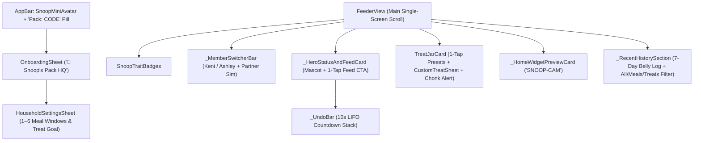

# 🎨 Who Fed Snoop? — UI Design Direction & Architectural Decisions

> **Design North Star:** Capture the personality of **Snoop**—a handsome, goofy, 90 lb black labradoodle who is a world-class actor at pretending he hasn't been fed—through a **whimsical, cartoony, Neo-Brutalist comic-storybook UI** that remains **100% faithful to the 2-Second Rule** on every phone screen size.

---

## 1. Persona & Creative Direction

### The Muse: Snoop (90 lb Black Labradoodle)
Snoop is a gentle giant with a fluffy jet-black curly coat, floppy doodle ears, soulful amber-brown puppy eyes, a big boopable nose, a golden collar tag (`SNOOP • 90 LB`), and a giant pink tongue.

The visual design translates his two signature real-life moods directly into the app's two core state-machine states:
1. **"Dramatic Starving 90-lb Floof" (`isFed == false`):** Five minutes before (or after) mealtime, Snoop acts as if he is wasting away to a mere 89.9 lbs, complete with pleading puppy-dog eyes, upturned eyebrows, and a rumbling empty bowl.
2. **"Happy Food-Coma Doodle" (`isFed == true`):** Once fed, he melts into a 90-lb puddle of pure contentment with squinty happy eyes, rosy cheeks, a lolling pink tongue, and a licked-clean bowl.

### Chosen Aesthetic: Neo-Brutalist Comic-Storybook
We chose a **Neo-Brutalist Comic-Storybook** aesthetic over flat corporate Material Design or heavy skeuomorphism for three reasons:
- **Instant Glanceability (<2 Seconds):** High-contrast ink borders (`2.0px–2.5px` in `#1C1917`), warm cream paper surfaces (`#FAF8F5` / `#FFFFDF8`), and state-coded card fills (Warm Amber vs. Vibrant Emerald) let a sleepy partner tell whether Snoop has been fed from across the kitchen before reading a single word.
- **Tactile Comic Affordance:** Solid, zero-blur offset drop shadows (`Offset(0, 4)` in `#1C1917`) make interactive buttons, preset chips, and smart pass cards look like physical comic stickers you want to tap.
- **Storybook Warmth:** Framing household settings as **"🐾 Snoop's Pack HQ"**, the active user selector as **"🥣 Scoop Holder"**, the home widget preview as **"SNOOP-CAM"**, and the 7-day history drawer as **"Belly Log"** turns a daily utility into an affectionate family ritual.

---

## 2. Color System & Theme Tokens (`lib/ui/core/app_theme.dart`)

All color and decoration primitives are centralized in `AppTheme` so every screen, modal sheet, and custom painter shares one cohesive palette.

| Token Category | Token Name | Hex | Role in UI |
| :--- | :--- | :--- | :--- |
| **Hungry State (Warm Amber)** | `hungryPrimary` | `#D97706` | Primary 1-tap feed CTA button, hungry bowl fill, active focus rings |
| | `hungrySurface` | `#FFFBEB` | Hero card background when Snoop needs a meal; preset treat chip fill |
| | `hungryBorder` | `#FCD34D` | Backdrop halo behind hungry Snoop mascot |
| **Fed State (Vibrant Emerald)** | `fedPrimary` | `#059669` | Fed bowl fill, settings save CTA, positive status accents |
| | `fedSurface` | `#ECFDF5` | Hero card background when Snoop is fed; active treat jar pill |
| | `fedBorder` | `#6EE7B7` | Backdrop halo behind happy Snoop mascot |
| **Snoop Character Palette** | `snoopCoatBlack` | `#1E1B18` | Snoop's curly black coat, dark comic banners, Snoop-Cam widget card |
| | `snoopCurlHighlight` | `#3D3732` | Curly fur texture arcs, muzzle shading, bottom-sheet drag handles |
| | `snoopTonguePink` | `#FF6B8B` | Goofy lolling tongue, rosy cheeks, soft "Chonk Alert!" & error banners |
| | `snoopCollarGold` | `#FBBF24` | Collar & dog tag (`SNOOP • 90 LB`), Pack Code pill, Undo & Snoop-Cam accents |
| | `snoopSkyAccent` | `#38BDF8` | Hungry cartoon drool droplet, VIP Sitter pass badge, handsome trait pill |
| **Paper & Ink Neutrals** | `pageBackground` | `#FAF8F5` | Warm storybook paper scaffold background |
| | `creamCard` | `#FFFFDF8` | Elevated card, speech bubble, and input surface |
| | `inkDark` | `#1C1917` | Primary typography, `2px–3px` comic outlines, and hard offset shadows |
| | `inkMuted` | `#57534E` | Secondary metadata, timestamps, and helper subtitles |

### Shared Comic Decoration Helpers
- **`AppTheme.comicCardDecoration(...)`:** Standardized `BoxDecoration` combining `creamCard` (or state surface), `Border.all(color: inkDark, width: 2.5)`, rounded corners (`24px` default), and a crisp `BoxShadow(color: inkDark, offset: Offset(0, 4), blurRadius: 0)`.
- **`AppTheme.comicPillDecoration(...)`:** Stadium-rounded (`borderRadius: 999`) pill container with a `2px` dark ink border for meal window badges, collar tags, and treat counters.

---

## 3. Custom Vector Mascot Architecture (`lib/ui/core/snoop_mascot.dart`)

### Decision: Procedural `CustomPaint` vs. External Image/Lottie Assets
Instead of bundling static PNGs or external Lottie JSON files, Snoop is rendered procedurally in Dart using `CustomPaint` (`_SnoopCartoonPainter` and `_SnoopMiniAvatarPainter`) combined with layered Flutter widgets:
1. **Zero Asset Bundle Overhead & Instant Load:** No network or disk image decoding; renders on the first frame in both Android APK and Flutter Web builds.
2. **Resolution Independence:** Crisp vector curves at any device pixel ratio (`1.0x` to `4.0x`).
3. **Dynamic Personalization:** The collar tag (`${petName.toUpperCase()} • 90 LB`) and comic speech bubble dynamically interpolate the household's pet name, active meal window label (`Breakfast`, `Lunch`, `Dinner`, `Late Snack`), and the name of the human who fed him.
4. **Deterministic Widget Tests:** Because all animations use finite transitions (`AnimatedSwitcher` and `AnimatedContainer`) rather than infinite `AnimationController.repeat()` loops, `WidgetTester.pumpAndSettle()` completes deterministically in CI without timeouts.

### Mascot Components
- **`SnoopMascotIllustration`:**
  - **Speech Bubble (`_ComicSpeechBubble`):** Positioned above Snoop with a custom-painted comic pointer tail (`_SpeechTailPainter`) and state-specific quotes.
  - **Floating Comic Stickers (`_FloatingComicSticker`):** Tilted callout pills (`💭 RUMBLE...` / `🦴 FEED ME?` when hungry; `💖 BELLY FULL!` / `✨ YUM!` when fed).
  - **Curly Doodle Canvas (`_SnoopCartoonPainter`):** Draws Snoop's ring of 14 overlapping head curls, crown floof highlights, floppy curly ears, golden collar, whisker puffs, glossy boopable nose, state-dependent eyes/brows/mouth, resting curly paws, and kibble bowl.
- **`SnoopMiniAvatar`:** Compact circular badge (`34px–44px`) of Snoop's face that switches between happy (`isHappy: true`) and hungry (`isHappy: false`) expressions in the `AppBar`, `Snoop-Cam` widget preview, and history rows.
- **`SnoopTraitBadges`:** Wrapping comic pills at the top of the main view (`🐕‍🦺 90 lb Black Labradoodle`, `✨ 100% Handsome`, `🤪 Professional Goofball`).

---

## 4. Responsive Phone Layout & Typography Decisions

A key engineering requirement is that the UI must look balanced and legible across **standard portrait phone screens** (`360×800` compact Android, `375×812` iPhone Mini/SE, `390×844` iPhone 14/15, `412×915` Pixel) while also fitting inside Flutter's default `800×600` landscape widget-test viewport without scrolling off-screen.

### 1. Native-Scale Speech Bubbles (Never Squashed by `FittedBox`)
- **Problem Avoided:** Wrapping the entire `SnoopMascotIllustration` inside a single `FittedBox` caused the speech bubble text to scale down to `<6px` when constrained vertically.
- **Decision:** `_ComicSpeechBubble` is rendered *outside* the canvas `FittedBox` at native widget text scale (`13.5px` bold italic on phones, `12.0px` in compact mode, `height: 1.3`). Only the `280×210` cartoon drawing `Stack` is placed inside `FittedBox(fit: BoxFit.contain)`.

### 2. Viewport-Height Adaptive Density (`isCompactHeight`)
- `FeederView` inspects `MediaQuery.sizeOf(context).height < 680` (`isCompactHeight`):
  - **Standard Portrait Phones (`height >= 680`):**
    - Hero card uses `20px` padding, `26px` (`FontWeight.w900`, `letterSpacing: -0.4`) status headlines, `14.5px` subheadlines, a full `190px`-tall mascot illustration, and a tall `18px`-padded 1-tap CTA button (`17.5px` label).
    - Main `ListView` uses `14px` vertical section spacing and `12px` top/bottom padding.
  - **Compact / Test Viewports (`height < 680`):**
    - Enables `compact: true` on `SnoopMascotIllustration` (`95px` canvas height) and tightens vertical paddings (`6px` section gaps) so the hero CTA button, Undo bar, and history toggle remain directly tappable in `800×600` automated tests.

### 3. Narrow-Screen (`360px`) Horizontal Overflow Guardrails
- **Wrap-First Control Bars:** All multi-element horizontal headers use `Wrap` instead of rigid `Row`s:
  - `_MemberSwitcherBar` uses nested `Wrap`s so `"🥣 Scoop Holder:"`, the `Keni` / `Ashley` `ChoiceChip`s, and the `"Simulate Partner Tap"` button wrap cleanly on `360px`-wide screens.
  - `_HeroStatusAndFeedCard` wraps the meal window pill (`🌅 BREAKFAST WINDOW`) and reset countdown pill (`⏰ Resets at 2:00 PM`).
  - Hero CTA button labels are wrapped in `Flexible` + `FittedBox(fit: BoxFit.scaleDown)` so custom pet names or custom meal window names never clip or ellipses-truncate on narrow phones.

---

## 5. Feature-Level UX & Interaction Decisions

### 1. Hero Status Card & Double-Feeding Protection (`FeederView`)
- **Hungry State:** Displays a prominentamber 3D comic button (`I FED SNOOP BREAKFAST`). One tap logs the meal for the active member, updates the Android Home Screen Widget, and notifies the partner.
- **Fed State:** Immediately locks the primary button (`ALREADY FED (KENI)`) to prevent accidental double-feeding, while exposing a lightweight secondary text action (`🦴 Gave an extra meal or treat? Log bonus feed`) for intentional extra portions.

### 2. 10-Second LIFO Undo Stack (`_UndoBar`)
- **Decision:** Rather than a single-slot undo, `FeederViewModel` maintains a Last-In-First-Out (LIFO) undo stack with a 10-second countdown timer. If a user logs a regular meal and then logs a bonus meal, tapping **`UNDO`** reverts the bonus meal first and restores the Undo bar for the underlying regular meal.

### 3. Snoop's Treat Jar & Soft "Chonk Alert!" (`TreatJarCard`)
- **1-Tap Presets + Custom Sheet:** Provides 1-tap comic pills for common rewards (`🍖 Training 8c`, `🪥 Dental Chew 65c`, `🥜 PB Kong 110c`, `🦴 Biscuit 40c`) plus a `+ Custom` bottom sheet (`CustomTreatSheet`) with a `1x..10x` portion stepper, kcal input, and optional note.
- **Non-Blocking Over-Limit Warning:** When Snoop exceeds his daily treat goal (`dailyTreatLimit`, default `5`), the allowance pill turns pink (`⚠️ 6 / 5 TREATS • CHONK ALERT!`) and a soft warning banner appears. Crucially, preset chips remain enabled—blocking the UI would discourage partners from logging extra treats honestly.

### 4. Customizable Meal Windows & 24h Cycle Preview (`HouseholdSettingsSheet`)
- Accessible from **Pack HQ** or the Treat Jar's tune icon, allowing households to configure `1..6` daily meal windows (presets for `Breakfast`, `Lunch`, `Dinner`, `Late Snack`, or custom labels/emojis) and adjust the daily treat allowance (`1..20`).
- **Live 24-Hour Cycle Preview (`_CyclePreviewCard`):** A dark comic card (`snoopCoatBlack` with `snoopCollarGold` border) dynamically computes and displays the exact time span of every enabled window and explains how late-night checks before the first morning window wrap to the previous evening's logical date.
- **Non-Destructive Schedule Edits:** If a user disables or deletes a window that was *already logged today*, a warm amber notice (`schedule_logged_today_notice`) reassures them that today's recorded feeding event remains preserved in the 7-Day Belly Log.

### 5. Snoop's Pack HQ & Collectible Smart Passes (`OnboardingSheet`)
- Frames household creation/joining and deep-link sharing inside a comic modal sheet (`🐾 Snoop's Pack HQ`).
- Styles the three `whofedsnoop.com` deep links as color-coded collectible pass cards (`_SmartPassCard`) with 1-tap clipboard copy:
  - **`PACK INVITE`** (`https://whofedsnoop.com/join/{CODE}`) — Warm Amber accent
  - **`KIBBLE BIN`** (`https://whofedsnoop.com/tap/{ID}`) — Vibrant Emerald accent
  - **`VIP SITTER`** (`https://whofedsnoop.com/s/{CODE}`) — Sky Blue & Snoop Black accent
- **Submission Guards:** All modal sheets (`OnboardingSheet`, `CustomTreatSheet`, `HouseholdSettingsSheet`) guard against rapid double-taps on submit buttons (`_isSubmitting` / `_didPop`) so `Navigator.pop()` can never be triggered twice.

---

## 6. Verification & Regression Guardrails

Every design and layout decision is backed by automated widget tests in `test/ui/`:
- **`test/ui/feeder_view_test.dart`:** Verifies 1-tap meal logging, 10s LIFO undo, partner feed simulation, NFC `/tap` & Dog Sitter `/s` deep links, `SnoopMascotIllustration` state transitions, and multi-device portrait phone layouts (`360×800`, `375×812`, `390×844`, `412×915`) with zero `RenderFlex` overflows and native typography scales.
- **`test/ui/treat_jar_card_test.dart`:** Verifies 1-tap preset chips, `CustomTreatSheet` validation, "Chonk Alert!" over-limit banners, and narrow `360×800` phone layout.
- **`test/ui/household_settings_sheet_test.dart`:** Verifies live 24-hour cycle preview, preset/custom window creation up to 6 slots, minimum 15-minute gap validation, logged-today safety notices, and `360×800` layout.
- **`test/ui/onboarding_sheet_test.dart`:** Verifies Pack HQ mode switching, schedule/treat summary card routing, smart-link clipboard copy, and double-tap submission guards.
