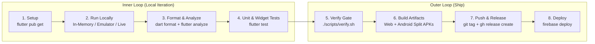

# 🛠️ Who Fed Snoop? — Developer Loop (`build → test → release → deploy`)

> **Living Document:** This runbook is the canonical source of truth for developing, testing, verifying, building, releasing, and deploying **Who Fed Snoop?**. It is automatically kept in sync with the codebase via [`AGENTS.md`](../AGENTS.md), [`.agents/hooks.json`](../.agents/hooks.json), [`.githooks/pre-commit`](../.githooks/pre-commit), and [`scripts/verify.sh`](../scripts/verify.sh).

---

## Overview: Inner & Outer Dev Loop



---

## 1. Stack & Toolchain Prerequisites

| Layer | Technology / Version | Config / Entrypoint |
| :--- | :--- | :--- |
| **App Framework** | Flutter (Stable) • Dart SDK `^3.5.0` | [`pubspec.yaml`](../pubspec.yaml), [`lib/main.dart`](../lib/main.dart) |
| **Static Analysis & Format** | `flutter_lints: ^5.0.0`, strict types, `page_width: 100` | [`analysis_options.yaml`](../analysis_options.yaml) |
| **Backend & Hosting** | Firebase Auth (Anonymous), Cloud Firestore (`nam5`), Firebase Hosting | [`firebase.json`](../firebase.json), [`.firebaserc`](../.firebaserc), [`firestore.rules`](../firestore.rules) |
| **Cloud Functions** | Firebase Functions v2 (`Node 20`, TypeScript `^5.6.0`) | [`functions/package.json`](../functions/package.json), [`functions/src/index.ts`](../functions/src/index.ts) |
| **Android Native + Widget** | Kotlin (`JVM 17`), `AppWidgetProvider`, App Links & NFC `NDEF_DISCOVERED` | [`android/app/build.gradle.kts`](../android/app/build.gradle.kts), [`MainActivity.kt`](../android/app/src/main/kotlin/com/whofedsnoop/who_fed_snoop/MainActivity.kt), [`WhoFedSnoopWidgetProvider.kt`](../android/app/src/main/kotlin/com/whofedsnoop/who_fed_snoop/WhoFedSnoopWidgetProvider.kt) |
| **Web Target** | Flutter Web SPA (`whofedsnoop.com` / `who-fed-snoop.web.app`) | [`web/`](../web), [`firebase.json`](../firebase.json) |
| **macOS Desktop Target** | Flutter macOS (`macos/`) | [`macos/`](../macos) |
| **CLI Tools** | `flutter`, `dart`, `firebase` (`firebase-tools`), `gh` (GitHub CLI), `node` (v20) | System `PATH` |

---

## 2. Bootstrap & Repository Setup

```bash
# 1. Install Dart/Flutter packages
flutter pub get

# 2. Enable automatic git hooks (keeps dev docs synced with stack changes)
./scripts/install-git-hooks.sh

# 3. (Optional) Install Cloud Functions dependencies if editing functions/
cd functions && npm install && cd ..
```

---

## 3. Running Locally (3 Backend Modes)

[`lib/main.dart`](../lib/main.dart) supports compile-time `--dart-define` flags so you can iterate completely offline, against local Firebase Emulators at **$0 cloud cost**, or against the live `who-fed-snoop` Firebase project.

### Mode A: Offline In-Memory Mode (Fastest UI Iteration, $0 Cost)
Forces `InMemoryHouseholdRepository` with pre-seeded Snoop household data and partner simulation—no network or Firebase required:
```bash
flutter run -d chrome --dart-define=USE_IN_MEMORY_REPO=true
```

### Mode B: Firebase Local Emulator Suite ($0 Cloud Cost, Real Rules & Transactions)
Runs local Auth (`:9099`), Firestore (`:8080`), Hosting (`:5000`), and Emulator UI (`:4000`) configured in [`firebase.json`](../firebase.json):
```bash
# Terminal 1: Start local Firebase emulators
firebase emulators:start

# Terminal 2: Launch app wired to localhost:8080 (Firestore) & localhost:9099 (Auth)
flutter run -d chrome --dart-define=USE_FIREBASE_EMULATOR=true
```
Open `http://localhost:4000` to inspect Firestore documents, subcollections (`feedings`, `treats`), and Auth sessions live.

### Mode C: Live Firebase (`who-fed-snoop`)
Connects to the live `who-fed-snoop` project via [`lib/firebase_options.dart`](../lib/firebase_options.dart) (automatically falls back to `InMemoryHouseholdRepository` if offline or on an unconfigured platform):
```bash
# Web (Chrome)
flutter run -d chrome

# Connected Android device or running AVD
flutter run
```

### Testing Deep Links Locally (`whofedsnoop.com` Routes)
| Route | Behavior | Local Web Test Example |
| :--- | :--- | :--- |
| `/join/{CODE}` | 1-Tap Partner Household Join | Launch Chrome and navigate to `/join/SNOOP4` |
| `/tap/{HOUSEHOLD_ID}` | Instant NFC Kibble-Bin Auto-Feed | Navigate to `/tap/household_snoop_01` |
| `/s/{TOKEN}` | Zero-Install Dog Sitter Web Pass | Navigate to `/s/SNOOP4` |

On Android devices/emulators, test App Links / NFC intent routing with `adb`:
```bash
adb shell am start -a android.intent.action.VIEW -d "https://whofedsnoop.com/tap/household_snoop_01" com.whofedsnoop.who_fed_snoop
```

---

## 4. Formatting, Linting & Static Analysis

[`analysis_options.yaml`](../analysis_options.yaml) enforces `strict-casts`, `strict-inference`, `strict-raw-types`, `page_width: 100`, and `trailing_commas: preserve`.

```bash
# Format all app & test Dart files in-place
dart format lib test

# Check formatting without modifying files (CI mode)
dart format --output=none --set-exit-if-changed lib test

# Run strict static analysis (treats info-level hints as fatal)
flutter analyze --fatal-infos

# Type-check Cloud Functions (when modifying functions/src/index.ts)
cd functions && npm run build && cd ..
```

---

## 5. Testing (`flutter test`)

The automated test suite covers domain logic, repository state & Firestore contracts, MVVM view models, and multi-viewport widget interactions—with zero live network dependencies.

```bash
# Run the entire unit & widget test suite
flutter test

# Run individual layers
flutter test test/domain/
flutter test test/data/
flutter test test/ui/

# Run a single test file or filter by test name
flutter test test/ui/feeder_view_test.dart --plain-name "TreatJarCard"
```

### Current Test Suite Map
| Suite | File | What It Verifies |
| :--- | :--- | :--- |
| **Domain** | [`test/domain/meal_window_test.dart`](../test/domain/meal_window_test.dart) | Default & custom meal schedules, overnight window cutoffs, logical dates, and `whofedsnoop.com` deep-link parsing (`/join`, `/tap`, `/s`). |
| **Data / Repo** | [`test/data/household_repository_test.dart`](../test/data/household_repository_test.dart) | Household CRUD, deterministic meal IDs, custom schedules, treat tracking, and repository invariants. |
| **ViewModel** | [`test/data/feeder_view_model_test.dart`](../test/data/feeder_view_model_test.dart) | Non-clobbering 10-second LIFO Undo stack across interleaved meals & treats, optimistic state, and error handling. |
| **Feeder UI** | [`test/ui/feeder_view_test.dart`](../test/ui/feeder_view_test.dart) | 1-tap feed, 10s Undo bar, partner feed banner, lazy 7-Day Belly Log filters (All / Meals / Treats), live schedule edits, and portrait phone layout matrix (`360×800`, `375×812`, `390×844`, `412×915`). |
| **Onboarding UI** | [`test/ui/onboarding_sheet_test.dart`](../test/ui/onboarding_sheet_test.dart) | Pack HQ modal, persona initialization, `50/40/6` input bounds, double-tap submit guards, and `360×800` / `412×915` overflow checks. |
| **Treats & Settings UI** | [`test/ui/treats_and_schedule_ui_test.dart`](../test/ui/treats_and_schedule_ui_test.dart) | `TreatJarCard` 1-tap presets, `CustomTreatSheet`, non-blocking Chonk Alert, treat deletion drawer, and `HouseholdSettingsSheet` schedule editor. |

### UI Test Authoring Guardrails
1. **Finite Animations Only:** Keep widget transitions finite (`AnimatedSwitcher`, `AnimatedContainer`)—avoid unbounded repeating animations so `tester.pumpAndSettle()` remains deterministic.
2. **Small-Phone Viewport Safety:** Any new card, sheet, or banner must render with zero `RenderFlex` overflows at `360×800` and `isCompactHeight` (`< 680`).

---

## 6. Pre-Push Verification Gate (`./scripts/verify.sh`)

Always run the single-command verification gate before pushing or cutting a release:

```bash
./scripts/verify.sh
```

[`scripts/verify.sh`](../scripts/verify.sh) executes five sequential checks (`set -euo pipefail`):
1. **Dev-Loop Doc Sync (`./scripts/check-dev-docs-sync.sh --check`):** Ensures stack/build/config edits didn't leave this document stale.
2. **Dart Formatting:** `dart format --output=none --set-exit-if-changed lib test`
3. **Static Analysis:** `flutter analyze --fatal-infos`
4. **Automated Tests:** `flutter test`
5. **Production Web Compilation:** `flutter build web --release`

*(Note: GitHub Actions template lives at [`scripts/github-ci-workflow.yml`](../scripts/github-ci-workflow.yml); move/copy to `.github/workflows/ci.yml` when activating GitHub Actions CI.)*

---

## 7. Building Release Artifacts

### Web Bundle (`whofedsnoop.com` / `who-fed-snoop.web.app`)
```bash
flutter build web --release
# Output: build/web/
```

### Android Split-ABI Release APKs
```bash
flutter build apk --release --split-per-abi
```
Outputs under `build/app/outputs/flutter-apk/`:
- `app-arm64-v8a-release.apk` *(primary modern 64-bit Android phone APK attached to GitHub Releases)*
- `app-armeabi-v7a-release.apk`
- `app-x86_64-release.apk`

> **Note on Android Signing:** [`android/app/build.gradle.kts`](../android/app/build.gradle.kts) currently signs `release` builds with debug keys for direct sideloading (`flutter run --release` / GitHub APK installs). Configure a dedicated Play App Signing upload keystore before publishing to Google Play.

### macOS Desktop App
```bash
flutter build macos --release
# Output: build/macos/Build/Products/Release/
```

---

## 8. Release & Deployment Runbook (`build → push → release → deploy`)

Follow this exact sequence when cutting a new release (e.g., `v0.5.0` / build `+5`):

### Step 1 — Bump Version in `pubspec.yaml`
Update `version: X.Y.Z+N` in [`pubspec.yaml`](../pubspec.yaml) (incrementing both the semantic version `X.Y.Z` and integer build number `+N` so Android allows clean in-place APK upgrades).

### Step 2 — Format, Verify & Build Artifacts
```bash
dart format lib test
./scripts/verify.sh
flutter build apk --release --split-per-abi
```

### Step 3 — Commit, Tag & Push to GitHub
```bash
git add -A
git commit -m "chore(release): bump version to X.Y.Z+N"
git tag vX.Y.Z
git push origin main
git push origin vX.Y.Z
```

### Step 4 — Publish GitHub Release with `arm64-v8a` APK
```bash
gh release create vX.Y.Z \
  build/app/outputs/flutter-apk/app-arm64-v8a-release.apk \
  --title "Who Fed Snoop vX.Y.Z (<Short Theme>)" \
  --notes "<Release summary and highlights>"
```

### Step 5 — Deploy to Firebase (`who-fed-snoop`)
```bash
# Deploy Firestore Security Rules, Firestore Indexes, and Web Hosting (build/web)
firebase deploy --only firestore,hosting --project who-fed-snoop
```
- **Live URLs:** [https://whofedsnoop.com](https://whofedsnoop.com) and [https://who-fed-snoop.web.app](https://who-fed-snoop.web.app)
- **Cloud Functions (`functions/`):** `onMealLogged` and `onTreatLogged` (2nd-Gen Functions) require upgrading `who-fed-snoop` from Firebase **Spark** to **Blaze**. Once Blaze is active and `functions/node_modules` is installed:
  ```bash
  cd functions && npm run build && cd ..
  firebase deploy --only functions --project who-fed-snoop
  ```

---

## 9. How This Documentation Auto-Updates as the Stack Evolves

Three automated guardrails ensure `docs/DEVELOPMENT_LOOP.md` never drifts out of date:

1. **Always-On Agent Workspace Rule ([`AGENTS.md`](../AGENTS.md)):** Instructs AI coding agents in every session to update `docs/DEVELOPMENT_LOOP.md` (and [`README.md`](../README.md) if quickstart commands change) whenever dependencies, scripts, targets, flags, or Firebase/CI configs evolve.
2. **Antigravity `Stop` Lifecycle Hook ([`.agents/hooks.json`](../.agents/hooks.json) → [`scripts/check-dev-docs-sync.sh`](../scripts/check-dev-docs-sync.sh)):** Automatically inspects uncommitted changes at the end of an agent turn. If stack/tooling manifests changed (ignoring routine `version:` bumps in `pubspec.yaml`) without updating `docs/DEVELOPMENT_LOOP.md`, the hook prompts the agent to update the docs before finishing.
3. **Verification Gate & Git Pre-Commit Hook ([`scripts/verify.sh`](../scripts/verify.sh) & [`.githooks/pre-commit`](../.githooks/pre-commit)):** Blocks `./scripts/verify.sh` and `git commit` when staged/working-tree stack manifests change without `docs/DEVELOPMENT_LOOP.md`.
   - *Escape hatch for genuine non-dev-loop config tweaks:* `SKIP_DEV_DOCS_SYNC=1 git commit ...` or `SKIP_DEV_DOCS_SYNC=1 ./scripts/verify.sh`.
