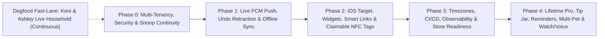

# 🚀 Who Fed Snoop? — Productization Gap Analysis & Roadmap

> **Purpose:** Comprehensive engineering, security, UX, and business audit of the `who-fed-snoop` codebase as-is (`v0.3.0+`), paired with a phased roadmap to productize **Who Fed Snoop?** for public release across **Android, iOS, and Web (`whofedsnoop.com`)** while preserving its **2-Second Rule**, **Neo-Brutalist Snoop Mascot identity**, and **near-\$0/month cloud cost guardrails**.
>
> **Companion Docs:**
> - [Original Project Vision, Product & Business Plan](./PROJECT_VISION_AND_PLAN.md)
> - [UI Design Direction & Architectural Decisions](./DESIGN_DIRECTION_AND_DECISIONS.md)
> - [Dogfood Feedback & Bug Log (`FB-###`)](./FEEDBACK_LOG.md)

---

## 1. Alignment with Project Vision & Design Guardrails

Every recommendation in this roadmap is anchored to the non-negotiable decisions established in [`PROJECT_VISION_AND_PLAN.md`](./PROJECT_VISION_AND_PLAN.md) and [`DESIGN_DIRECTION_AND_DECISIONS.md`](./DESIGN_DIRECTION_AND_DECISIONS.md):

1. **"Personal & Family First, Commercial-Ready Second":** Keni, Ashley, and Snoop's live household (`household_snoop_01`) and existing physical NFC kibble-bin stickers (`https://whofedsnoop.com/tap/household_snoop_01`) must continue working with zero disruption while isolating new public installs into their own households.
2. **"Snoop as Mascot" Brand Identity:** Keep **Who Fed Snoop?** as the memorable, character-led brand name on `whofedsnoop.com` and the app stores. Snoop remains the procedural `CustomPaint` mascot face of the app, while each household personalizes their own pet's name, optional traits/weight, and member names inside **Pack HQ**.
3. **Preserve Procedural `CustomPaint` & Responsive Neo-Brutalist UI:** Retain centralized `AppTheme` comic tokens, zero-asset vector rendering (`lib/ui/core/snoop_mascot.dart`), finite `AnimatedSwitcher` / `AnimatedContainer` transitions (ensuring `WidgetTester.pumpAndSettle()` stays deterministic in CI), native-scale `_ComicSpeechBubble` outside `FittedBox`, `isCompactHeight` (`< 680`), and `Wrap`-first `360px` layouts.
4. **Zero-Subscription, Lightweight Side-Income Model:** Avoid recurring subscription fatigue and heavy support overhead in favor of the three-pronged monetization model:
   - **100% Free Core App + "Buy Snoop a Treat" Tip Jar (\$1 – \$5)**
   - **One-Time "Pro Household" Lifetime Unlock (\$2.99 – \$4.99 once per household, flips `isPro = true`)**
   - **Physical + Digital Bundle: "The Snoop Tap Tag" (\$10 – \$15 waterproof NTAG213 sticker/magnet)**
5. **Strict Cloud Cost Guardrails (Scale-to-Zero Firebase Blaze):** Because the \$3.99 one-time Lifetime Pro model has no recurring MRR to absorb fixed \$15–\$25/month SaaS floors, stay on **Firebase Blaze** (`$0/mo` up to ~2,000 daily active households; `~$6–$10/mo` at 10,000 daily active households) while enforcing single-document default streaming (`households/{id}` = 1 read per state change), lazy history loading, deferred Anonymous Auth + auto-cleanup, zero-scan reminder scheduling, Artifact Registry image pruning, and optional Cloudflare static CDN shielding.

---

## 2. Executive Summary: Top 4 Production Blockers Today

Before sharing `whofedsnoop.com` publicly or submitting to Google Play / Apple App Store, four P0 issues in the current codebase must be resolved:

1. **50-Visitor Auto-Join Timebomb (`lib/main.dart`, `lib/data/repositories/firestore_household_repository.dart`):**
   - On every launch, `main.dart` signs the visitor in via Anonymous Auth and calls `ensureDefaultHousehold(memberUid: initialMemberUid, memberName: 'Keni')`.
   - Every stranger who visits `whofedsnoop.com` or opens the APK is written into Keni & Ashley's live `households/household_snoop_01` document under the name `'Keni'`.
   - Once `household_snoop_01.members` reaches 50 UIDs, `firestore.rules` (`data.members.size() <= 50`) rejects the 51st visitor with `PERMISSION_DENIED`. The `try { ... } on Object` catch-all in `main.dart` then **silently drops all future visitors into the ephemeral `InMemoryHouseholdRepository`** with zero warning that their logs vanish on reload.
2. **Client Push Notifications Are Unwired + `/tap` Notification Deep-Link Bug (`pubspec.yaml`, `functions/src/index.ts`):**
   - Cloud Functions (`onMealLogged`, `onTreatLogged`) dispatch FCM multicast messages, but **`firebase_messaging` is not installed in `pubspec.yaml`**, `AndroidManifest.xml` lacks `POST_NOTIFICATIONS` and the `snoop_feedings_high` channel, and clients always write `'fcmToken': null`. `collectRecipientTokens()` therefore returns `[]` for every event in production.
   - Furthermore, `onMealLogged` in `functions/src/index.ts` sets `deepLink: "https://whofedsnoop.com/tap/${householdId}"`. Tapping a partner's *"Snoop is fed!"* notification routes to the **NFC auto-feed endpoint** (`/tap/{id}`), which will accidentally log the *next* meal if tapped after a window transition.
3. **Global Household Read Leak & Unprotected Self-Join (`firestore.rules`):**
   - `match /households/{householdId}` currently sets `allow read: if isAuthenticated();`. Because Anonymous Auth grants `request.auth != null` to anyone automatically, any client can `list` all documents in `/households`, read every family's `joinCode`, member names, and `fcmToken`s, call `update` via `isValidMemberJoinUpdate()` to add their UID to `members`, and then **delete all historical `feedings` and `treats`** (`allow delete: if isHouseholdMember(householdId)`).
4. **Broken `.well-known` Hosting Deploy & Debug Release Signing (`firebase.json`, `web/.well-known/assetlinks.json`, `android/app/build.gradle.kts`):**
   - `firebase.json` includes `"**/.*"` inside `hosting.ignore`, which **excludes `build/web/.well-known/assetlinks.json` during `firebase deploy --only hosting`** (causing `/.well-known/assetlinks.json` to fall through to the `** -> /index.html` SPA rewrite).
   - `web/.well-known/assetlinks.json` still contains `"REPLACE_WITH_PLAY_APP_SIGNING_SHA256_FINGERPRINT"`, and `android/app/build.gradle.kts` signs `release` builds with `signingConfigs.getByName("debug")`.

---

## 3. Comprehensive Gap Audit (As-Is Codebase)

### 3.1 Multi-Tenancy, Onboarding & Local Persistence
| Gap | Codebase Location | Impact & Detail |
| :--- | :--- | :--- |
| **Hardcoded Snoop bootstrap** | [`lib/main.dart`](../lib/main.dart), [`firestore_household_repository.dart`](../lib/data/repositories/firestore_household_repository.dart) | Auto-joins every anonymous visitor into `household_snoop_01` as `'Keni'`. Needs clean first-run onboarding while preserving `household_snoop_01` solely for Keni & Ashley. |
| **No local device persistence** (`[FB-001]`) | [`pubspec.yaml`](../pubspec.yaml), [`feeder_view_model.dart`](../lib/ui/features/feeder/view_models/feeder_view_model.dart) | `shared_preferences` is not installed. Cold-starting from the Home Widget or NFC `/tap` resets `_currentMemberName` to `'Keni'` on Ashley's phone (`switchActiveMember` is RAM-only), and refreshing Web resets `_householdId` to `'household_snoop_01'`. |
| **Hardcoded Snoop/Keni/Ashley copy on non-Snoop households** | [`feeder_view.dart`](../lib/ui/features/feeder/views/feeder_view.dart), [`snoop_mascot.dart`](../lib/ui/core/snoop_mascot.dart), [`onboarding_sheet.dart`](../lib/ui/features/onboarding/views/onboarding_sheet.dart) | Every household sees `'90 lb Black Labradoodle • Official Belly Tracker'`, `SnoopTraitBadges` (`90 lb Black Labradoodle`), collar tag `'${petName} • 90 LB'`, speech bubble `'89.9 lbs'`, `Keni` / `Ashley` Scoop Holder `ChoiceChip`s, and the `'SNOOP-CAM • ANDROID HOME WIDGET PREVIEW'` card even on Web/iOS. |
| **High-collision 2-digit join codes** | [`firestore_household_repository.dart`](../lib/data/repositories/firestore_household_repository.dart) (`_generateJoinCode`) | Generates `4 pet letters + 10..99` (only **90 combinations per pet name**) with zero uniqueness check. Common dog names (`LUNA`, `BELLA`, `MAXI`, `MILO`) collide almost immediately, and `.limit(1)` joins the wrong family's dog. |
| **Silent demo fallback on init error** | [`lib/main.dart`](../lib/main.dart) (`on Object`) | Any network/Firebase init error silently swaps in `InMemoryHouseholdRepository`, leading users to think their meal logs synced to their partner when nothing was saved. |

### 3.2 Security, Authentication & Sitter Access Control
| Gap | Codebase Location | Impact & Detail |
| :--- | :--- | :--- |
| **Public household enumeration** | [`firestore.rules`](../firestore.rules) (`allow read: if isAuthenticated()`) | Allows scraping all households, join codes, member names, and push tokens with a single anonymous `getDocs(collection(db, 'households'))` query. |
| **Unverified member self-injection & history wipe** | [`firestore.rules`](../firestore.rules) (`isValidMemberJoinUpdate`) | Any authenticated UID knowing a `householdId` can add itself to `members` without proving knowledge of a secret code, gaining full permission to edit schedules/petName and delete `feedings`/`treats`. |
| **Permanent full-privilege Dog Sitter link** | [`onboarding_sheet.dart`](../lib/ui/features/onboarding/views/onboarding_sheet.dart), [`feeder_view_model.dart`](../lib/ui/features/feeder/view_models/feeder_view_model.dart) | `/s/{joinCode}` reuses the household's permanent `joinCode` and permanently adds `'Dog Sitter'` as a full member in `household.members`—no expiration, no 1-tap revocation after a trip, no read-only feeding/care notes, and full delete/settings access. |
| **Anonymous-only identity (no recovery or deletion)** | [`firebase.json`](../firebase.json), [`lib/main.dart`](../lib/main.dart) | Reinstalling the app, getting a new phone, or clearing Safari/Chrome storage permanently orphans the user's UID (leaving ghost entries in `household.members`). Also lacks **Account & Data Deletion**, which Apple mandates under App Store Review Guideline 5.1.1(v) whenever user accounts/profiles exist. |
| **Missing Firebase App Check** | Flutter client & Firebase console | Without Play Integrity, Apple App Attest / DeviceCheck, and reCAPTCHA Enterprise, bots can mint anonymous UIDs and exhaust Firestore/Functions quotas. |

### 3.3 Push Notifications, Cloud Cost & Backend Triggers
| Gap | Codebase Location | Impact & Detail |
| :--- | :--- | :--- |
| **Spark vs. Blaze deployment & spend-cap gap** | [`PROJECT_VISION_AND_PLAN.md`](./PROJECT_VISION_AND_PLAN.md), [`functions/src/index.ts`](../functions/src/index.ts) | 2nd-Gen Cloud Functions (`onMealLogged`, `onTreatLogged`) and Cloud Scheduler require Firebase **Blaze** (pay-as-you-go), which has **no native hard spend cap**. Needs `minInstances: 0`, `maxInstances`, App Check, Artifact Registry image pruning (`<0.5 GiB` free cap), `<= 3` Cloud Scheduler jobs, and GCP budget/kill-switch alerts so Blaze stays at \$0.00/month within free-tier quotas. |
| **Eager cold-start Anonymous Auth MAU bloat** | [`lib/main.dart`](../lib/main.dart) (`signInAnonymously`) | `main.dart` calls `signInAnonymously()` unconditionally on every cold start—including web crawlers, iMessage/Slack link previews, and casual Demo Mode visitors on `whofedsnoop.com`—risking Identity Platform's 50,000 free MAU ceiling (`$0.0055/MAU` overage) unless auth is deferred until pack creation/join and Anonymous Auto-Cleanup is enabled. |
| **FCM client missing + single-token schema** | [`pubspec.yaml`](../pubspec.yaml), [`household.dart`](../lib/domain/models/household.dart), [`functions/src/index.ts`](../functions/src/index.ts) | `fcmToken` is a single nullable string per UID (breaks multi-device users and exposes tokens inside the main household doc), APNs headers are missing for iOS, and dead tokens (`registration-token-not-registered`) are never pruned. |
| **10-Second Undo vs. Instant Push race** | [`functions/src/index.ts`](../functions/src/index.ts) | `onMealLogged` fires immediately on `onDocumentCreated`. If Keni bumps the button and taps **UNDO** 3 seconds later, Ashley already received *"🐾 Snoop is fed!"* and may skip feeding Snoop for real. Needs `onDocumentDeleted` collapse/retraction push (`tag` / `apns-collapse-id`). |
| **History stream read limit drift** | [`firestore_household_repository.dart`](../lib/data/repositories/firestore_household_repository.dart) vs. [`PROJECT_VISION_AND_PLAN.md`](./PROJECT_VISION_AND_PLAN.md) | Vision doc specifies `.limit(14)` for lazy history, but repository currently streams `limit = 50` feedings + `limit = 50` treats (**up to 100 reads** per history expansion). Lowering default limit to `20` protects free-tier reads. |
| **Viral Flutter Web Hosting bandwidth exposure** | [`firebase.json`](../firebase.json) (`hosting`) | Even with zero raster assets (`CustomPaint` mascot), Flutter Web's CanvasKit/Wasm bundle (~2–3 MB) against Firebase Hosting's `360 MB/day` (~10.8 GB/mo) free transfer tier (`$0.15/GB` overage) can incur egress charges during a viral social spike unless fronted by Cloudflare CDN / Cloudflare Pages. |

### 3.4 Native Platforms (iOS, Android, NFC & Web)
| Gap | Codebase Location | Impact & Detail |
| :--- | :--- | :--- |
| **Missing `ios/` target & ecosystem** | Repo root, [`firebase_options.dart`](../lib/firebase_options.dart) | No `ios/` directory (`macos/` exists, `ios/` does not). Couples very frequently mix iPhone + Android; public launch needs iOS build target, APNs, Universal Links (`apple-app-site-association`), iOS WidgetKit (Home + Lock Screen), and CoreNFC support. |
| **Home Widget stale when partner feeds** (`[FB-003]`) | [`WhoFedSnoopWidgetProvider.kt`](../android/app/src/main/kotlin/com/whofedsnoop/who_fed_snoop/WhoFedSnoopWidgetProvider.kt) | Widget `SharedPreferences` only update when the *local* Flutter UI is open or on coarse OS window ticks. When your partner feeds Snoop from *their* phone while your app is closed, your home screen widget stays stale until you open the app. |
| **Home Widget oversized (`4×1`) & lacks Dark Mode** (`[FB-002]`) | [`who_fed_snoop_widget_info.xml`](../android/app/src/main/res/xml/who_fed_snoop_widget_info.xml), [`widget_background_hungry.xml`](../android/app/src/main/res/drawable/widget_background_hungry.xml) | Forces a full-width `4×1` (`250dp`) row and hardcodes bright light pastels (`#FFFBEB` / `#ECFDF5`) with no `values-night` / `drawable-night` theme, glaring against OS Dark Mode home screens. |
| **High-friction third-party NFC setup** | [`README.md`](../README.md) (§2) | Users currently must install a third-party app (*NFC Tools* by Wakdev) and manually configure NDEF URI records without doubling `https://`. Crucial gap if selling **"The Snoop Tap Tag"** commercially! |
| **Offline `runTransaction` failure in low-signal pantries** | [`firestore_household_repository.dart`](../lib/data/repositories/firestore_household_repository.dart) (`logFeeding`) | Cloud Firestore `runTransaction` requires live network connectivity and **fails offline**, whereas deterministic `WriteBatch` writes queue cleanly in Firestore's offline cache when tapping an NFC sticker in a basement/garage pantry. |
| **Device-local timezone skew** | [`meal_window.dart`](../lib/domain/models/meal_window.dart) (`ActiveMealWindow.forTime`) | Uses `now.toLocal()` on each phone instead of an explicit household IANA timezone (`household.timezone`). A traveling partner in a different timezone sees shifted window cutoffs and can log under the wrong `windowDate` / `windowId`. |
| **Boilerplate Web PWA & social metadata** | [`web/index.html`](../web/index.html), [`web/manifest.json`](../web/manifest.json) | Still uses `"who_fed_snoop"`, `"A new Flutter project."`, and `#0175C2` instead of brand metadata, `#FAF8F5` cream theme colors, and OpenGraph preview cards for `/join/{CODE}` and `/s/{TOKEN}` iMessage/SMS shares. |

### 3.5 Quality Gates, Monetization Wiring & Documentation Drift
| Gap | Codebase Location | Impact & Detail |
| :--- | :--- | :--- |
| **Inactive GitHub Actions workflow & 0 backend tests** | [`scripts/github-ci-workflow.yml`](../scripts/github-ci-workflow.yml), `test/` | CI YAML sits in `scripts/` instead of `.github/workflows/ci.yml`, so GitHub Actions does not execute it. Zero Firebase Emulator tests exist for the 546-line `firestore.rules`, `FirestoreHouseholdRepository`, or `functions/`. |
| **`isPro` & monetization unwired** | [`household.dart`](../lib/domain/models/household.dart), [`firestore.rules`](../firestore.rules) | `isPro` exists on `Household` and is write-protected in `firestore.rules`, but no Tip Jar, One-Time Lifetime Pro IAP, or feature entitlement checks exist yet. |
| **Minor doc-vs-code drift** | [`DESIGN_DIRECTION_AND_DECISIONS.md`](./DESIGN_DIRECTION_AND_DECISIONS.md) | Design doc cites `dailyTreatLimit` default `5`, preset calories `8c/65c/110c/40c`, and test filenames `treat_jar_card_test.dart` / `household_settings_sheet_test.dart`, whereas code uses default `4`, `15c/85c/120c/45c`, and consolidated [`test/ui/treats_and_schedule_ui_test.dart`](../test/ui/treats_and_schedule_ui_test.dart). |

---

## 4. Phased Productization Roadmap

---

### Dogfood Fast-Lane — Live Household Bugs & UX Polish (Continuous)
**Goal:** Give Keni, Ashley, and Snoop immediate fixes and daily-use improvements on `household_snoop_01` without waiting on public-launch multi-tenancy or store submission phases.

- **Canonical Tracker:** [`docs/FEEDBACK_LOG.md`](./FEEDBACK_LOG.md) (`FB-###` IDs).
- **Triage Rule:** Whenever daily household dogfooding uncovers a bug, UX papercut, or idea, it is logged and deduplicated against §2–§4 first:
  - **Fix Now (`Dogfood Queue`):** Daily pain points or self-contained slices of Phases 0–4 that improve Keni & Ashley's live workflow right away.
  - **Phase-Linked (`Phase 0`–`Phase 4`):** Broader productization items cross-referenced inline below via `[FB-###]` tags.

---

### Phase 0 — Multi-Tenant Isolation, Security Hardening & Founder Continuity
**Goal:** Make the app safe for arbitrary strangers to open without polluting `household_snoop_01` or exposing user data, while keeping Keni & Ashley's live setup untouched.

1. **Zero-Downtime Founder Protection, Deferred Anonymous Auth & Clean First-Run Onboarding:**
   - Remove `ensureDefaultHousehold` from [`lib/main.dart`](../lib/main.dart).
   - **Defer `signInAnonymously()` & Enable Auto-Cleanup:** Do not mint an Anonymous Auth UID on cold start when no persisted pack or deep link is present. Keep landing-page browsing and *"Try Snoop Demo Mode"* (`InMemoryHouseholdRepository`) 100% unauthenticated (`0` Auth MAUs for bots, link previews, and casual visitors), calling `signInAnonymously()` only when a user creates/joins a pack or opens `/join/{code}`, `/tap/{token}`, or `/s/{token}`. Enable **Firebase Auth Anonymous Account Auto-Cleanup** in the console so dormant unlinked guest sessions never count toward Identity Platform's 50k MAU ceiling.
   - Add `shared_preferences` to persist `activeHouseholdId`, `memberName` (device-bound Scoop Holder `[FB-001]`), and `knownHouseholdIds` locally across app restarts, Home Widget launches, NFC `/tap` intents, and browser reloads.
   - Present first-time visitors (who did not arrive via `/join/{code}`, `/tap/{token}`, or `/s/{token}`) with a Neo-Brutalist **Welcome to Pack HQ** screen (*"Start My Dog's Pack"* vs. *"Join Partner's Pack"* + *"Try Snoop Demo Mode"*).
   - Migrate/preserve `household_snoop_01` (`isPro: true`) specifically for Keni & Ashley and purge any stray anonymous UIDs.
2. **Lock Down `firestore.rules` & Zero-Function Join Lookup:**
   - Restrict `/households/{householdId}` to `allow get: if isHouseholdMemberOrActiveSitter(householdId); allow list: if false;`.
   - Add a lightweight `/joinCodes/{code}` lookup collection (`{ householdId, createdAt }`) with `allow get: if isAuthenticated(); allow list: if false;` so joining by 6-character code stays `<200ms` and costs **1 Firestore read + 0 Cloud Function invocations**.
   - Require `joinCode` proof on member self-join updates (`request.resource.data.joinCode == resource.data.joinCode` paired with unguessable code lookup or invite secret).
   - Upgrade `_generateJoinCode` to unambiguous 6-char Crockford Base32 (`ABCDEFGHJKLMNPQRSTUVWXYZ23456789` — over **1 billion** combinations) verified atomically against `/joinCodes/{code}`.
3. **Scoped, Revocable Dog Sitter Passes (`/s/{sitterToken}`):**
   - Separate `sitterToken` (random 12-char URL-safe token with optional `expiresAt` and 1-tap **"Rotate / Revoke Pass"** button in Pack HQ) from the permanent `joinCode`.
   - Restrict sitters in `firestore.rules` so they can log meals/treats and undo *their own* logs within 10 minutes, view pet care/portion notes, and **cannot** delete household history or modify schedules.
4. **Decouple Snoop Brand Mascot from Pet-Specific Copy:**
   - Keep Snoop as the procedural `CustomPaint` mascot, while adding optional `petSubtitle` / `weightLbs` fields on `Household`:
     - When tracking Snoop (`household_snoop_01`), show the classic `'90 lb Black Labradoodle'` badges and `'90 LB'` tag.
     - For other pets (e.g. *Bella*), show `${petName.toUpperCase()}` on the golden collar tag, weight-neutral comic starving quotes (*'"I have literally never been fed in my entire life! Need Breakfast!"'*), dynamic member badges from `household.members`, and move the `SNOOP-CAM` widget preview card into Pack HQ / Settings.

**Phase 0 Exit Criteria:**
- Firebase Emulator rule tests prove anonymous `list` and non-member `get`/`update` on `/households` return `PERMISSION_DENIED`.
- Cold-launching `whofedsnoop.com` or using *"Try Snoop Demo Mode"* mints `0` Firebase Auth UIDs; cold-restarting after creating/joining a pack on Android and Web preserves the user's household and member persona.

---

### Phase 1 — End-to-End Push Notifications, Account Recovery & Offline Pantry Sync
**Goal:** Deliver reliable `<2s` partner notifications across devices, handle 10-second Undo gracefully, support offline NFC taps, and protect users from losing their pack on reinstall.

1. **Wire Client & Web Push Notifications (`firebase_messaging` + `flutter_local_notifications`):**
   - Add contextual notification opt-in right after creating/joining a pack (*"Alert me when my partner feeds {petName}"*).
   - Store per-device FCM tokens in a private subcollection (`households/{id}/devices/{installationId}`) with `{ uid, token, platform, updatedAt }` so multi-device users (phone + web/tablet) receive pushes on all devices and tokens aren't exposed to guests.
   - Add `POST_NOTIFICATIONS`, `snoop_feedings_high` channel creation on Android, and `firebase-messaging-sw.js` + VAPID key support for Web Push (PWA on iOS 16.4+ & desktop/Android Chrome).
2. **Fix `/tap` Push Bug & Add Undo Push Retraction (`functions/src/index.ts`):**
   - Change meal notification `deepLink` from `/tap/${householdId}` to `https://whofedsnoop.com/h/${householdId}` (safe view-only route).
   - Add `onMealDeleted` (`onDocumentDeleted("households/{householdId}/feedings/{feedingId}")`) using deterministic `tag: feedingId` (Android) and `apns-collapse-id: feedingId` (iOS) so tapping **UNDO** replaces the earlier *"Snoop is fed!"* alert with *"↩️ Undo: {actor} reverted {mealLabel} — {petName} still needs to eat!"*.
   - Add APNs payload config and automatic cleanup of `messaging/registration-token-not-registered` tokens.
3. **Background Home Widget Sync, Compact Sizing & Dark Mode (`[FB-002]`, `[FB-003]`):**
   - Handle data-only / background FCM messages in `FirebaseMessaging.onBackgroundMessage` on Android (and Notification Service Extension / background push on iOS) + native Kotlin Firestore single-doc fallback & window-cutoff alarm so `WhoFedSnoopWidgetProvider` updates immediately when a partner feeds, undoes a meal, or a window rolls over—even when the app is closed.
   - Support compact `2×1` (`targetCellWidth="2"`) responsive widget layouts and `values-night` / `drawable-night` OS Dark Theme surfaces on Android.
4. **Optional 1-Tap Account Linking & App Store Account Deletion:**
   - Keep zero-friction Anonymous Auth on Day 1, and add optional **"Back Up My Pack (Sign in with Apple / Google)"** in Pack HQ using `linkWithCredential` so reinstalling or switching phones restores all households.
   - Add **"Leave Pack / Delete My Account & Data"** flow required for App Store & Google Play approval.
5. **Offline-First Meal Logging & History Read Cap:**
   - Refactor regular deterministic meal writes (`YYYY-MM-DD_windowId`) to support offline Firestore write queueing when tapping an NFC sticker in a zero-bar basement/pantry, falling back from transaction to offline-safe batch when offline.
   - Tighten default `watchRecentFeedings` and `watchRecentTreats` limits from `50` to `20` (with `"Load More"`) per [`PROJECT_VISION_AND_PLAN.md`](./PROJECT_VISION_AND_PLAN.md).

**Phase 1 Exit Criteria:**
- Partner receives push + updated Home Screen Widget within 2 seconds while app is killed; tapping Undo within 10 seconds updates both push notification and widget; Airplane-Mode NFC tap syncs automatically on reconnect.

---

### Phase 2 — iOS Parity, WidgetKit, Smart Links & Claimable "Snoop Tap Tags"
**Goal:** Bring full feature parity to iPhone households and make physical **Snoop Tap Tag** stickers effortless to set up and sell.

1. **Generate & Configure `ios/` Native Target:**
   - Run `flutter create --platforms=ios .`, configure bundle ID (`com.whofedsnoop.app`), `GoogleService-Info.plist`, `firebase_options.dart`, APNs key, Associated Domains (`applinks:whofedsnoop.com`), App Groups (`group.com.whofedsnoop.shared`), and CoreNFC entitlements.
2. **iOS SwiftUI WidgetKit (Home Screen + Lock Screen + Interactive Button):**
   - Build `WhoFedSnoopWidget` in SwiftUI matching the Warm Amber / Vibrant Emerald comic aesthetic across `systemSmall`, `systemMedium`, and Lock Screen `accessoryRectangular` families.
   - Use iOS 17+ `Button(intent: LogMealIntent())` so iPhone users can log meals in 1 tap directly from their Home Screen or StandBy display.
3. **Fix `.well-known` Hosting & Verify App Links / Universal Links:**
   - Update [`firebase.json`](../firebase.json) `hosting.ignore` (`!/.well-known/**`) and add `application/json` headers + rewrite exclusions for `/.well-known/assetlinks.json` and `/.well-known/apple-app-site-association`.
   - Configure production Play App Signing SHA-256 and Apple Team ID fingerprints so `/join/*`, `/tap/*`, `/t/*`, and `/s/*` open directly in the native app with zero browser disambiguation dialogs.
4. **Dual NFC Experience (Commercial Pre-Encoded `/t/{tagCode}` + In-App DIY Writer):**
   - **For Commercial \$10–\$15 "Snoop Tap Tag" Orders:** Pre-encode stickers in bulk with unique claim URLs (`https://whofedsnoop.com/t/{TAG_CODE}`). When a customer receives their sticker in a stamped envelope and taps it for the first time, the app prompts **"Link this Snoop Tap Tag to {petName}'s Kibble Bin?"**—zero NFC-writing apps or technical steps needed!
   - **For DIY Blank Amazon Stickers:** Add a built-in **"Program Blank NFC Sticker"** wizard inside Pack HQ using `nfc_manager` (`Ndef.write`) so users never need third-party apps.

**Phase 2 Exit Criteria:**
- Physical NFC tap, Home Screen interactive widget, and `/join` Universal/App Links work end-to-end on physical iPhone and Android devices.

---

### Phase 3 — Household Timezones, CI/CD, Blaze Safety & Store Submission
**Goal:** Eliminate edge-case bugs, automate backend/frontend testing, enforce cloud billing protections, and pass App Store & Google Play review.

1. **Household-Anchored IANA Timezone (`timezone` package):**
   - Store `timezone` (e.g. `'America/Los_Angeles'`) on `Household` at creation time (editable in `HouseholdSettingsSheet`).
   - Compute `ActiveMealWindow.forTime` and `logicalDateFor` in the household's timezone rather than device-local time so traveling partners and Cloud Scheduler reminders never drift out of sync.
2. **Activate GitHub Actions CI & Emulator Test Suites:**
   - Move [`scripts/github-ci-workflow.yml`](../scripts/github-ci-workflow.yml) to `.github/workflows/ci.yml`.
   - Add automated CI jobs for:
     - Flutter formatting, `flutter analyze --fatal-infos`, widget/unit tests, Web release build, and Android release AAB build.
     - `functions` TypeScript compilation + unit tests.
     - Firebase Local Emulator tests covering `firestore.rules` security matrix and `FirestoreHouseholdRepository` transactions/batches.
   - Sync minor doc-vs-code constants in [`DESIGN_DIRECTION_AND_DECISIONS.md`](./DESIGN_DIRECTION_AND_DECISIONS.md).
3. **Observability, Blaze Cost Armor & Viral Web Bandwidth Shield:**
   - Enable **Firebase App Check** (Play Integrity, App Attest, reCAPTCHA Enterprise) across Firestore and Functions.
   - Set `{ minInstances: 0, maxInstances: 5, memory: "256MiB" }` on all 2nd-gen Cloud Functions, configure an **Artifact Registry cleanup policy** (retain only the latest 2 container revisions per function so CI/CD builds stay permanently under the `0.5 GiB` free storage cap), and keep total `onSchedule` jobs `<= 3` across the GCP billing account (Cloud Scheduler's free tier).
   - Configure GCP billing alerts at \$1 / \$5 / \$10 wired to a Pub/Sub billing-alert/kill-switch handler to guard against runaway trigger loops (since Blaze has no native hard spend cap).
   - *(Optional Zero-Code Hybrid)* Front `whofedsnoop.com` static assets (`build/web`) with **Cloudflare CDN or Cloudflare Pages** for **\$0 unlimited static bandwidth** during viral social spikes while keeping Firebase Auth, Firestore, Functions, and FCM for dynamic state.
   - Add `firebase_crashlytics` (fatal + async errors) and privacy-light `firebase_analytics` funnel events (`household_created`, `partner_joined`, `meal_logged`, `nfc_tapped`).
4. **Release Signing, Branding Assets & Legal Compliance:**
   - Configure upload keystore signing + R8 rules in `android/app/build.gradle.kts`.
   - Generate crisp Snoop mascot adaptive launcher icons (`flutter_launcher_icons`), splash screens (`flutter_native_splash`), and OpenGraph social share cards + brand metadata in `web/index.html` and `web/manifest.json`.
   - Publish lightweight `/privacy` and `/terms` pages on `whofedsnoop.com` and complete Apple Privacy Nutrition Labels & Google Play Data Safety forms.
   - Run WCAG contrast & `Semantics` screen-reader pass on custom-painted `SnoopMascotIllustration` and interactive comic pills.

**Phase 3 Exit Criteria:**
- All CI checks green on `.github/workflows/ci.yml`; production builds live on TestFlight and Google Play Closed Testing with App Check active.

---

### Phase 4 — Three-Pronged Monetization (`isPro`), Smart Reminders & Expansion
**Goal:** Turn on the zero-overhead side-income streams and ship the Phase 3 vision features from [`PROJECT_VISION_AND_PLAN.md`](./PROJECT_VISION_AND_PLAN.md).

#### Free vs. One-Time Lifetime "Pro Household" (`isPro`) Matrix
> *Note:* Founder household `household_snoop_01` is permanently flagged `isPro: true`. One partner purchasing the **\$3.99 Lifetime Pro Household Unlock** sets `households/{id}.isPro = true` via verified purchase webhook/callable, unlocking Pro for every human in that household forever.

| Capability | Free Forever | Pro Household (\$3.99 Once) |
| :--- | :---: | :---: |
| 1-Tap Meal Tracking, 10s LIFO Undo & Real-Time Partner Push | ✅ | ✅ |
| Daily Treat Jar, Custom Treats & "Chonk Alert!" | ✅ | ✅ |
| Breakfast & Dinner Schedule (up to 2 daily windows, custom times) | ✅ | ✅ |
| 7-Day Belly Log History | ✅ | ✅ |
| Home Screen Status Widget (Read-Only Glance) | ✅ | ✅ |
| **Interactive 1-Tap Widget Action + Lock Screen Widgets** | — | ✅ |
| **3–6 Custom Meal Windows & Daily Meds/Supplement Toggle** | — | ✅ |
| **Smart Missed-Meal Reminders** (with Lock-Screen `[I Fed Snoop]` button) | — | ✅ |
| **Revocable Dog Sitter Web Passes** with Care & Portion Notes | — | ✅ |
| **NFC Tap-to-Feed** *(also auto-unlocked free when claiming an official Snoop Tap Tag!)* | — | ✅ |
| **Multi-Pet Tabs** (2+ pets in one household) & Unlimited History Export | — | ✅ |

#### Phase 4 Feature Deliverables
1. **Monetization Wiring (Zero Subscriptions):**
   - Integrate `in_app_purchase` / RevenueCat for the **One-Time "Pro Household" Unlock (\$3.99 non-consumable)** and **"Buy Snoop a Treat" Tip Jar (\$1.99 / \$4.99 consumables)**, verified server-side before setting `households/{id}.isPro = true`.
   - Add **"Get a Snoop Tap Tag (\$12 Free Shipping)"** card in Pack HQ linking to a 1-click Stripe Payment Link (auto-unlocking `isPro` or NFC support when the mailed `/t/{TAG_CODE}` sticker is claimed!).
2. **Smart Missed-Meal Reminders with Lock-Screen Action (Zero-Scan Cost Guardrail):**
   - Optional per-window cutoff alert (e.g., *"Remind us if Breakfast isn't logged by 9:30 AM"*), evaluated in `household.timezone` and dispatching an actionable notification with an instant **`[I Fed {petName}]`** lock-screen action button (`UNNotificationAction` / Android `BroadcastReceiver`).
   - **Strict Zero-Scan Architecture (Never Poll All Pro Households):** Avoid naive `onSchedule` collection scans (which would burn ~288,000 reads/day across 2,000 Pro households). Implement via either:
     - **Local-First Schedule + Silent Push Cancel (`0` Firestore reads):** Schedule local device notifications (`flutter_local_notifications` `zonedSchedule`) for the cutoff time and cancel/suppress them via the Phase 1.3 background FCM data push when any partner logs the meal; **or**
     - **Indexed Due-Queue / Cloud Tasks (`<= 1` read per empty tick):** Query only due reminders via an indexed `nextReminderAt` field (`.where('remindersEnabled', isEqualTo: true).where('nextReminderAt', isLessThanOrEqualTo: now)`, advancing `nextReminderAt` on meal log or dispatch) or enqueue per-window **Cloud Tasks** (1M free ops/month).
3. **Multi-Pet Tabs & Daily Meds Toggle (Single-Document Stream Guardrail):**
   - Allow Pro households with 2+ pets (e.g. *Snoop* + *Biscuit*) to switch pets via 1-tap header pills or *"Feed All Pets"*, plus an optional 1-tap daily medication/supplement pill (e.g. `💊 Apoquel` / `🦴 Joint Chew`) that stays faithful to the **2-Second Rule**.
   - Keep active daily pet summaries denormalized inside the single `households/{id}` document (`pets` map) rather than separate per-pet collection listeners so daily 2-second glances remain **1 Firestore read** regardless of pet count.
4. **Voice & Watch Shortcuts:**
   - Apple Siri App Intents & Shortcuts (*"Hey Siri, I fed Snoop"*), Google Assistant App Actions, Apple Watch complication/widget, and WearOS Tile.
5. **Opt-In Poop / Potty Check-In (`[FB-004]` — Late Phase 4 / Post-Launch):**
   - Optional household toggle (*"Track Poop / Walks"*) adding a compact 1-tap `💩 Poop Logged` pill (with optional `✅ Solid` / `⚠️ Soft` health tag for partner & sitter visibility and 10s LIFO Undo).
   - Denormalize `lastPoop` / `todayPoopCount` on `households/{id}` (and lazy-stream history only when expanded) to preserve the 1-read single-document cost guardrail and the **2-Second Rule**.

---

## 5. Pre-Launch Productization Checklist

- [ ] **Phase 0:** `ensureDefaultHousehold` removed from public cold start; `signInAnonymously()` deferred until pack create/join/deep-link + Anonymous Auto-Cleanup enabled (`0` MAUs for Demo Mode/bots); `household_snoop_01` preserved for Keni & Ashley; `shared_preferences` persistence active.
- [ ] **Phase 0:** `firestore.rules` blocks `list` and non-member `get`/`update` on `/households`; `/joinCodes/{code}` Crockford Base32 uniqueness enforced; `/s/{sitterToken}` scoped & revocable.
- [ ] **Phase 0:** Non-Snoop households render pet-neutral weight/trait copy and dynamic member chips while keeping Snoop as brand mascot.
- [ ] **Phase 1:** `firebase_messaging` wired on Android & Web; `/tap` push deep-link bug fixed to `/h/{id}`; `onMealDeleted` Undo collapse push live; offline batch queueing & `limit = 20` history cap verified.
- [ ] **Phase 1:** Optional Apple/Google account linking + App Store-compliant Account & Data Deletion implemented.
- [ ] **Phase 2:** `ios/` target, SwiftUI WidgetKit, CoreNFC, Universal Links (`apple-app-site-association`), and fixed `.well-known/assetlinks.json` deployed.
- [ ] **Phase 2:** Claimable `/t/{tagCode}` NFC sticker flow + in-app blank NFC writer shipped.
- [ ] **Phase 3:** Household IANA timezone wired; `.github/workflows/ci.yml` running Flutter + Functions + Firestore Emulator tests; App Check + Crashlytics + Artifact Registry cleanup (`<= 2` images) + `<= 3` Cloud Scheduler jobs + Blaze budget/kill-switch alerts (+ optional Cloudflare static CDN shield) enabled; Privacy Policy & release signing complete.
- [ ] **Phase 4:** \$3.99 Lifetime Pro Household IAP + Tip Jar + Snoop Tap Tag checkout + zero-scan Missed-Meal Reminders + single-doc Multi-Pet/Meds live.

