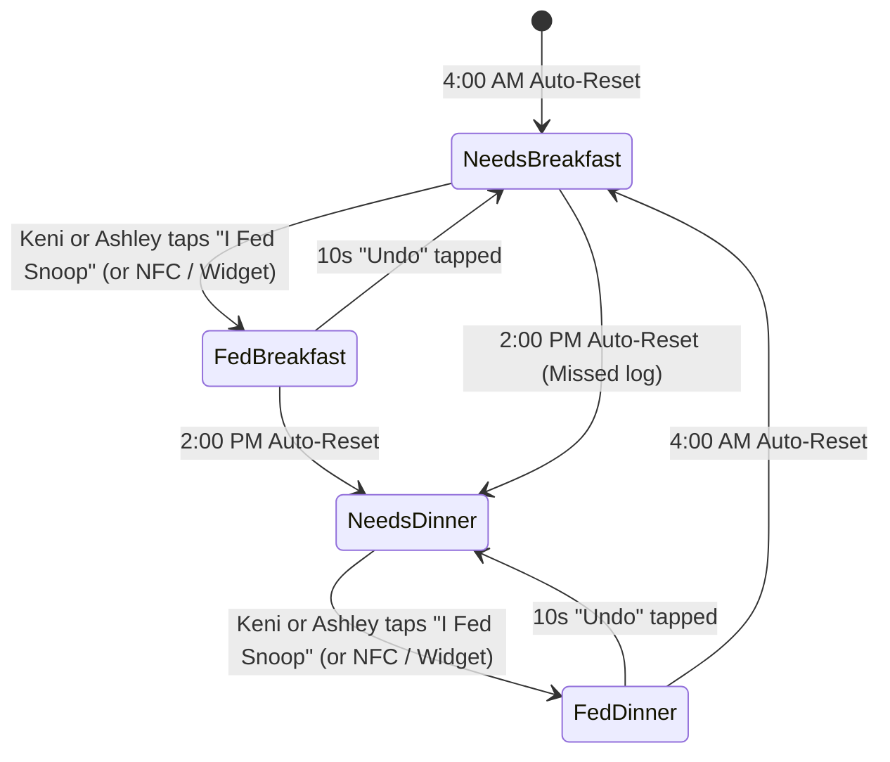
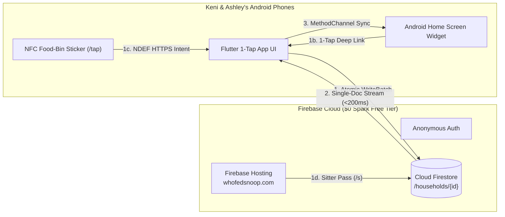

# 🐾 Who Fed Snoop? — Original Project Vision, Product Plan, Business Plan & Architecture

> **Origin Story:** Built by **Keni** and **Ashley** for our dog **Snoop**. The core problem is simple: dogs are world-class actors who will happily convince the second partner that they are starving five minutes after already eating. Existing pet apps require 5+ taps through bloated veterinary menus, so couples stop using them after three days and fall back to texting *"did u feed snoop?"*

---

## 1. Product Plan & Goals

### North Star: The "2-Second Rule"
Checking whether Snoop has been fed—or logging a meal and notifying your partner—must take **under 2 seconds** with minimal effort.

### Core Product Principles
1. **Personal & Family First, Commercial-Ready Second:**
   - Designed first and foremost for Keni, Ashley, and Snoop's daily routine on Android, while structured cleanly so any pet household can adopt it.
2. **Dead-Simple Meal Windows (Zero Manual Reset):**
   - The day automatically divides into two natural windows (customizable per household in **Pack HQ**):
     - **Breakfast Window (`04:00 – 13:59` default):** Opens in the *"Needs Breakfast 🥣"* state.
     - **Dinner Window (`14:00 – 03:59` default):** Automatically transitions to *"Needs Dinner 🍖"* while still showing when Breakfast was logged.
   - **Late-Night Continuation (`00:00 – 03:59`):** Checks or feedings after midnight stay attached to the previous evening's Dinner window rather than prematurely flipping to the next day.
3. **Idempotent Double-Feeding Protection:**
   - Regular meals use deterministic document IDs (`YYYY-MM-DD_breakfast` and `YYYY-MM-DD_dinner`). Even if Keni and Ashley tap **"I Fed Snoop"** at the exact same second on two different phones, Snoop cannot be double-logged.
4. **Forgiving UX (10-Second LIFO Undo Stack & Treat Jar):**
   - Accidental pocket taps or bumped NFC stickers can be reverted immediately via a **10-second Undo bar**.
   - A dedicated **Daily Treat Jar** tracks bonus snacks against a configurable daily treat budget so Snoop doesn't double-dip on treats either.

---

### Phased Feature Roadmap

| Phase | Focus | Capabilities |
| :--- | :--- | :--- |
| **Phase 1 (v0.1) — Core MVP** | Validate daily habit & instant sync for Keni & Ashley | • 6-character Household Join Code (`SNOOP4`) with zero-password Anonymous Auth • Automatic Breakfast/Dinner state machine • Giant 1-tap hero button + 10-second Undo • Real-time Cloud Firestore sync + instant partner notifications • Rolling 7-day meal & treat log |
| **Phase 2 (v0.2) — Zero-Open Friction** | Log & check status without opening the app | • **Native Android Home Screen Widget** (live status + 1-tap *"I Fed Snoop"* action button) • **NFC "Tap-to-Feed" Sticker Support** (`https://whofedsnoop.com/tap/{id}`) • **Dog Sitter Web Pass** (`https://whofedsnoop.com/s/{code}`) • **Customizable Meal Windows & Daily Treat Jar** |
| **Phase 3 (v1.0+) — Commercial & Pro Expansion** | Future business & convenience channels | • **Smart Late-Meal Reminders:** Conditional push notification if Snoop hasn't been fed by a cutoff time, with a lock-screen `[I Fed Snoop]` action button • **Voice / Watch Shortcuts:** Google Assistant / Siri / WearOS / Apple Watch tiles • **Multi-Pet & Daily Meds Toggle:** Optional tabs for households with multiple pets or daily supplements |

---

## 2. Business Plan (Fun & Lightweight Side-Income)

### Brand Positioning: "Snoop as Mascot"
- Keep **"Who Fed Snoop?"** as the memorable, story-driven indie brand name and mascot on [whofedsnoop.com](https://whofedsnoop.com) and the app stores.
- Inside the app (via **Pack HQ**), users can set their own dog's name (e.g., *Bella*), which dynamically updates their buttons (`I FED BELLA BREAKFAST`), notifications, and home screen widgets while Snoop remains the face of the brand.

### Three-Pronged Zero-Overhead Monetization
Because this is a lightweight side-income project, the business model avoids heavy customer support and recurring server costs:

1. **100% Free Core App + "Buy Snoop a Treat" Tip Jar (\$1 – \$5)**
   - Core 1-tap meal tracking and partner sync are free forever.
   - An optional tip jar lets happy dog owners support Keni, Ashley, and Snoop.
2. **One-Time "Pro Household" Unlock (\$2.99 – \$4.99 Lifetime)**
   - **No subscription fatigue:** One partner pays once to unlock Pro for the entire household.
   - **Pro Perks:** Interactive Home Screen Widgets, Smart Missed-Meal Reminders, Dog Sitter Guest Links, NFC Tag triggers, and Multi-Pet support.
   - **Near-100% Margin:** Because each household uses `<1 KB` of state and ~60 writes/month, a one-time \$3.99 unlock covers decades of cloud usage.
3. **Physical + Digital Bundle: "The Snoop Tap Tag" (\$10 – \$15)**
   - Sell a custom waterproof NFC vinyl sticker/magnet for the dog food bin alongside the free app.
   - Bulk NTAG213 stickers cost ~\$0.40/unit and ship in a standard First-Class envelope with a regular postage stamp (~85% gross margin, zero electronics support).

---

## 3. Technical Architecture & Cost Guardrails

### Tech Stack
- **Client:** **Flutter (Dart)** — Single codebase powering the native **Android APK** (`com.whofedsnoop.who_fed_snoop`), **Android Home Screen AppWidget** (`WhoFedSnoopWidgetProvider.kt`), **Flutter Web** (`whofedsnoop.com` / `who-fed-snoop.web.app`), and future **iOS** builds.
- **Backend:** **Firebase (Spark Free Tier — \$0.00/month)**
  - **Firebase Anonymous Auth:** Seamless device identity (`request.auth.uid`) with zero email/password friction.
  - **Cloud Firestore (`(default)` in `nam5`):** Real-time document streaming protected by hardened `firestore.rules`.
  - **Firebase Hosting:** Serves the web app and routes `whofedsnoop.com` deep links (`/join/*`, `/tap/*`, `/s/*`).
  - **Cloud Functions (`functions/`):** Ready-to-deploy 2nd-gen FCM push trigger (`onMealLogged`) whenever upgrading to Blaze is desired.

### Cloud Cost Guardrails
1. **Single-Document Default Streaming (>90% Read Reduction):**
   - `lastFeeding` is denormalized directly onto `households/{householdId}`.
   - Daily 2-second glances and widget updates stream **only 1 document** (`households/{id}`).
   - The 7-day `feedings` subcollection is **lazy-loaded on demand** only when a user expands the history drawer (capped at `.limit(14)`).
2. **Local-First & Emulator-First Verification:**
   - Automated tests (`flutter test`) run against `InMemoryHouseholdRepository` in milliseconds at zero cloud cost.
   - Local development supports `--dart-define=USE_FIREBASE_EMULATOR=true` against the Firebase Local Emulator Suite (`:8080` Firestore, `:9099` Auth, `:5000` Hosting).
3. **Automated Quality Gate (`./scripts/verify.sh`):**
   - Every change is verified through `dart format`, `flutter analyze --fatal-infos`, `flutter test`, and `flutter build web --release`.
